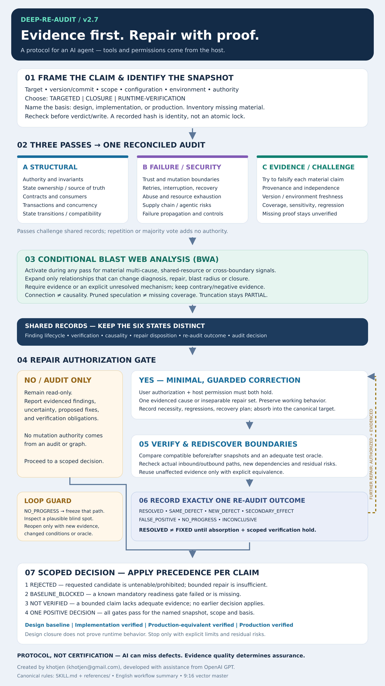

# Deep-Re-Audit v2.7

**An evidence-first AI skill for reviewing critical code, architecture, and technical blueprints.**

Created by khotjen (khotjen@gmail.com), developed with assistance from OpenAI GPT.

Deep-Re-Audit gives an AI assistant a structured way to ask: **What could fail, what evidence supports this conclusion, and what remains unverified?** It examines connected components, challenges assumptions, and checks whether a proposed fix creates problems elsewhere. When corrections are authorized, it guides a minimal repair and a focused re-audit.

This repository contains Markdown instructions and reference material. It is not a standalone application, vulnerability scanner, or autonomous execution engine. The AI host supplies the model, file access, tools, permissions, and execution environment.

## Start here

- [Installation](docs/INSTALLATION.md) — install the complete skill in a supported local host.
- [How it works](docs/HOW_IT_WORKS.md) — audit passes, evidence, dependency analysis, repair, and decisions.
- [Disclaimer](docs/DISCLAIMER.md) — limitations, authorization, and responsible use.
- [Skill instructions](SKILL.md) — the authoritative entry point for an AI agent.
- [Full-size workflow infographic](docs/assets/deep-re-audit-workflow.svg) — vector artwork that stays sharp when enlarged.



## What it helps review

- Critical application code and its upstream/downstream dependencies.
- Technical architecture and implementation blueprints.
- Transactions, concurrency, retries, recovery, and distributed messaging.
- Security and trust boundaries, supply-chain risks, and agentic systems.
- Claims that a design, implementation, or production deployment is ready.

## Three audit modes

| Mode | Use it for | Boundary |
| --- | --- | --- |
| `TARGETED` | A specific defect, module, or question | No full-system closure claim |
| `CLOSURE` | A canonical design or readiness baseline | All applicable mandatory gates must be satisfied |
| `RUNTIME-VERIFICATION` | Behavior in a named runtime | Requires evidence tied to the exact version, configuration, and environment |

## Example request

```text
Use deep-re-audit in TARGETED mode to review this payment retry flow.
Audit only; do not edit files.
Inspect its upstream and downstream contracts, idempotency, concurrency,
and recovery behavior. Cite the reviewed files and evidence.
Separate verified defects, assumptions, and unverified claims.
Recommend the smallest sufficient correction.
```

To permit a repair, explicitly name the scope and authorize editing. Host permissions still apply. A repair must be absorbed into the authoritative target and verified for the requested scope before a finding can be called `FIXED`.

## Important boundaries

The skill defaults to a read-only audit. It preserves proven-working behavior unless an evidenced defect or mandatory correction requires a change. Relationships in a dependency graph do not prove causality. Design closure does not prove runtime correctness. Missing evidence is reported as `NOT VERIFIED`; a failed or missing mandatory readiness gate uses `BASELINE_BLOCKED`.

The workflow can still miss defects or misinterpret evidence. Use appropriate tests and qualified review for consequential decisions. See the [disclaimer](docs/DISCLAIMER.md).

## Contents

The installable payload is `SKILL.md` plus the four files in `references/`. The `docs/` folder is user documentation and artwork. No third-party research skill, paid service, API key, or native notification implementation is bundled.

## Credit and voluntary support

Created by khotjen (khotjen@gmail.com), developed with assistance from OpenAI GPT.

If you find this skill helpful, you may support it with a voluntary donation via PayPal to **khotjen@gmail.com**. Donations are optional and do not affect access, audit conclusions, or support guarantees. No payment link or verified PayPal-account claim is supplied.

The skill preserves its creator/support notice in English, Simplified Chinese, and Indonesian. Public user documentation is in English. No standalone reuse license is included; contact the creator about licensing or reuse permissions.
